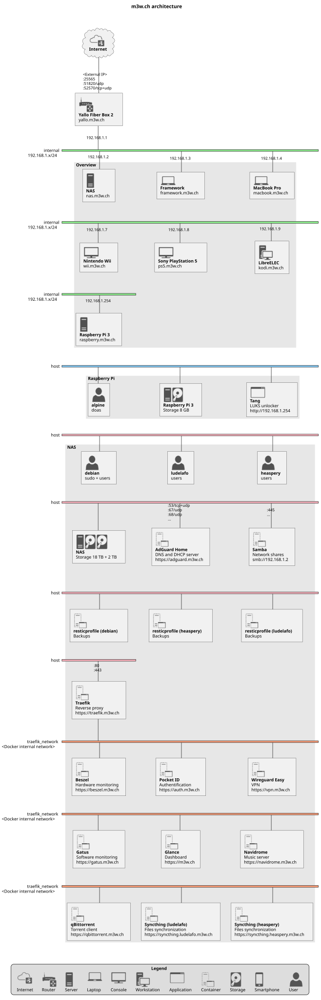

# m3w.ch



## Prerequisites

The following prerequisites must be filled to run these services:

- [Docker](https://docs.docker.com/get-docker/) must be installed.
- [Docker Compose](https://docs.docker.com/compose/install/) must be installed
  (it should be installed by default with Docker in most cases).

## Application configuration

The applications are deployed by [Doco-CD](./apps/doco-cd/README.md), which
polls this repository and deploys every stack listed in
[`.doco-cd.yaml`](./.doco-cd.yaml).

## Cheatsheet

### Generate a secure password

<https://linux.die.net/man/1/pwgen>

```bash
# Generate a password for computers
pwgen --secure [--capitalize] [--numerals] [-symbols] 20 1

# Generate a password for humans
pwgen --ambiguous [--capitalize] [--numerals] [-symbols] 20 1
```
